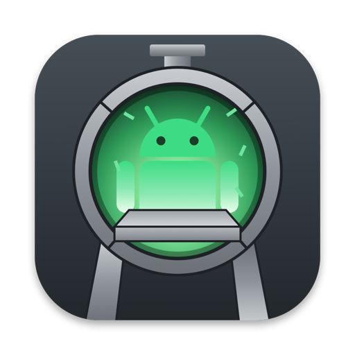
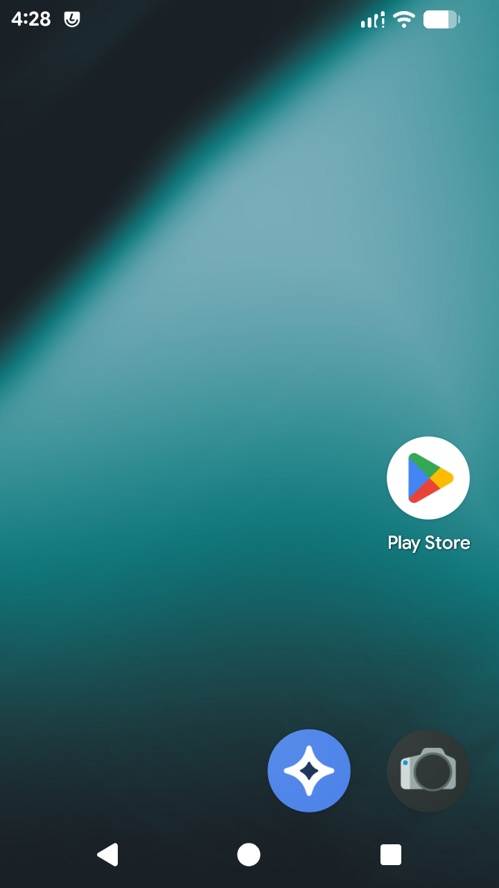

  

<h1 align="center">Kiln</h1>

<b>Android, fired up natively on your Mac.</b> 
An Android emulator built for Apple Silicon: hardware virtualization, real GPU acceleration, and controls made for games.

<code>0.0.9.3-beta</code> · macOS 14+ · Apple Silicon (M1 and later) · English and Português (Brasil)

<a href="https://github.com/NKS1608/kiln-android-emulator/releases/tag/v0.0.9.3-beta"><b>⬇ Download Kiln 0.0.9.3-beta</b></a> · <a href="https://ko-fi.com/nks1608">☕ Support Kiln</a>

---

> **This is a beta.** It runs Android 16 well enough for daily use and real games: some rough edges remain, so please
> tell us what breaks (see [Reporting a problem](#reporting-a-problem)).
> Enjoying it? [Support Kiln on Ko-fi](https://ko-fi.com/nks1608).

  

## Why Kiln

- **Native speed on Apple Silicon.** Kiln runs a real arm64 Android on Apple's Hypervisor framework, with no instruction
  translation in the way. The CPU runs at native speed, and a new instance reaches the home screen in about half a minute.
- **Real GPU acceleration.** OpenGL ES 3.1 and Vulkan in the guest are rendered on your Mac's GPU through Metal. Games pick
  their Vulkan renderer just as they would on a flagship phone.
- **Android 16, our own build.** The bundled image is Android 16 (LineageOS 23.2) built from source by Kiln, signed with
  Kiln's own keys and running with SELinux enforcing; Google apps can be added with **Install Zip** (see
  [About the Android image](#about-the-android-image)). Create an instance and you land straight on the home screen: no
  setup wizard, no lock screen.
- **Made for games.**
  - **Key mapping per game.** Drag taps, a WASD joystick and swipes onto the screen from a side panel, then press the key.
    Combos such as ⇧Q or ⌃1 work, and several keys can be held at once. Each game keeps its own mapping, and Kiln switches
    to it as soon as the game comes to the front. Press ⌃⌥ (Control+Option) to type in a game's chat.
  - **Camera control with the mouse.** A mouse area turns mouse movement into a thumb on the game's camera; the
    mouse buttons can be keys of their own, and the joystick takes any four keys.
  - **Game controllers.** A controller connected to your Mac shows up in Android as a standard gamepad, and only while it
    is connected.
  - **Mouse look** for shooters (in the default mapping), rotation that follows the game, and refresh rates up to 144 Hz.
- **Every instance is its own phone.** Pick from 16 device profiles (Samsung Galaxy S24 Ultra, Pixel 9 Pro, OnePlus 12,
  ROG Phone 8 and more): Android reports that phone's model, build fingerprint, baseband, board, system-on-chip and SKU. Each instance has its own
  SIM card (39 operators in 15 countries, or none) with a phone number of its country, IMEI, serial number and home
  Wi-Fi network. The battery drains and
  charges like a real one, and the mobile signal comes and goes.
- **Many instances.** Run several side by side, each in its own window and with its own Dock icon color. Choose the GPU a
  game should see (Adreno 740 or 650, Mali-G68) and size CPU and memory with Low, Medium or High presets, which scale with your Mac's performance cores and memory.
- **Install anything.** Install `.apk`, `.xapk`, `.apkm` and `.apks` bundles from the toolbar: split APKs are put
  together for you.
- **A developer's emulator too.** Open a shell inside Android with one click, with a real terminal (job control, `top`,
  `vi`) and no adb needed. Every instance logs its kernel, logcat and emulator output, and **Error Report** zips them
  for you. adb is there when you want it, opt-in per instance and reachable from your Mac only.

## Install

1. Download **`Kiln-0.0.9.3-beta.dmg`** from [Releases](https://github.com/NKS1608/kiln-android-emulator/releases/tag/v0.0.9.3-beta) and open it.
2. Drag **Kiln** to **Applications**.
3. The first time only: this beta is not notarized yet, so **right-click Kiln → Open**, then confirm. You can also use
   *System Settings → Privacy & Security → Open Anyway*.
4. Click **+** to create an instance, then **Start**.

Each instance gets its own disks, about 3 GB on your Mac to start, growing as you install apps (the storage size you
choose is what Android shows; your Mac only stores what is written). Plan on 4 GB of RAM per running
instance with the Low preset.

**Coming from an alpha?** Instances made with an earlier version show **Update** in the launcher: select one while it
is stopped and click **Update Android**. It gets this version's Android and keeps its apps, data and accounts. The old
system is kept: delete it with **Delete Previous System** once the instance works, or use **Go Back to Previous
System** if something is wrong. Most of what is new
below lives inside Android (graphics, sound, touch), so an instance gets it once updated. Instances from the first two
alphas, which used another Android image, cannot be updated in place: create a new instance for them.

## About the Android image

- **Android:** LineageOS 23.2 (Android 16), built from the LineageOS sources by Kiln for the `virtio_arm64only` device,
  with Kiln's graphics drivers, input, guest agent and fake modem built in. It is a `user` build signed with Kiln's own
  keys (`release-keys`), with SELinux enforcing. Thanks to jqssun's
  [android-lineage-qemu](https://github.com/jqssun/android-lineage-qemu), whose images earlier versions of Kiln shipped.
- **No Google apps.** Kiln does not include Google apps, which may not be redistributed. Apps that need Google Play
  services can still be used: download a GApps package for Android 16 (arm64), we recommend [MindTheGapps](https://github.com/MindTheGapps) or [NikGApps](https://nikgapps.com) Core, and
  install it with **Install Zip** (see below), ideally before the instance's first start. Kiln is tested with
  both.
- **Left out on purpose:** music player, recorder, calculator, clock, calendar, contacts, messaging, the setup wizard,
  always-on display, hotspot and tethering, and casting.

## Using Kiln

| To | Do |
| --- | --- |
| Create an instance | **+** in the launcher (pick the phone, screen and performance in its settings) |
| Get a newer Android for an instance | **Update Android** in the launcher, with the instance stopped (apps and data stay) |
| Back / Home / Recents | Toolbar buttons; middle click is Home |
| Long press (menus, text selection, moving icons) | Right click |
| Volume | Toolbar **−** and **+**, like a phone's volume keys |
| Install an app | Toolbar **Install APK**, then choose `.apk` / `.xapk` / `.apkm` / `.apks` files |
| Install a flashable zip (for example a GApps package) | **Install Zip** in the launcher, with the instance stopped |
| Open the recovery (factory reset, fastbootd) | **Recovery** in the launcher, with the instance stopped |
| Use a GSI instead of Kiln's Android | The arrow next to **+** → **New Instance with a GSI…** |
| Choose the storage size | Instance settings → **Storage**, before its first start |
| Choose the SIM's country | Instance settings → **SIM** (or **None**); **New** draws another SIM |
| Map keys for a game | Open the game, then toolbar **Key Mapping** (⌘K) |
| Turn a game's mapping on and off, and hold or free the mouse | **⌃⌥** (Control+Option), or F10 (a game opens with it off) |
| Play with mouse and keyboard, as on a PC | Key Mapping → **Mouse and keyboard mode**, then **⌃⌥** |
| Move a game's camera with the mouse | Key Mapping → **Mouse Area**, placed over the camera |
| Mouse look (default mapping) | **`** (backtick) |
| Full screen with only the game | The window's green button, or ⌃⌘F |
| Switch portrait / landscape | Toolbar **Rotate** (⌘R) |
| Open a shell in Android | **Shell** in the launcher, while the instance runs |
| Save the logs for a bug report | **Error Report** in the launcher |

Power users get the same through `kilnctl`, the command-line tool inside the app:
`/Applications/Kiln.app/Contents/Helpers/kilnctl` (run it alone for the list of commands).

## What's new in 0.0.9.3-beta

- **Games run at full speed again.** 0.0.9.2 told Android how the chosen phone's CPU cores differ in speed, and Android
  then crowded games' heavy work onto the one "fast" core, while your Mac's cores are all alike: games such as Genshin
  Impact lost frames. Android now sees every core as equally fast again. The phone's clusters and clock speeds are still
  shown to apps.
- **Smoother OpenGL ES games.** Android waits less for the Mac while a game draws, and handles the memory games ask for
  on every frame far more cheaply inside the emulator. In our tests Genshin Impact's busy scenes went from 25-45 fps to
  48-60, with much shorter stutters.
- **A new Android build:** instances show **Update** in the launcher. Their apps and data stay, and Google apps installed
  with **Install Zip** in 0.0.9.2 are installed again.

## Also new in 0.0.9.2-beta

- **GPS at a place you choose.** Give an instance a location (its settings, or `kilnctl set <name>
  location=<latitude>,<longitude>`) and Android's GPS reports it, standing still. Without one there is no GPS fix, as
  indoors.
- **Mobile data.** With a SIM card, turning on **Mobile data** in Android connects through the operator's network (its
  APN), and apps that check for a cellular connection see one. It starts off, as before.
- **Microphone.** An instance can use your Mac's microphone (**Microphone** in its settings, off by default). It is open
  only while an app in Android records; macOS asks for permission the first time.
- **The phone's CPU.** Android now sees the chosen phone's CPU clusters and their clock speeds (for example the
  Galaxy A53's 2.0 and 2.4 GHz cores), shared out over the instance's CPUs. Your Mac's cores are all used as before;
  only what Android is told changes.
- **A TEE for new instances.** Their keystore runs outside Android, on your Mac, with keys of their own kept in the
  instance: apps see hardware-backed keys (Trusted Environment) instead of software ones. Instances made before keep their
  keys as they are.
- **Thermal readings.** Android reports a cool phone, so games that ask about heat do not hold themselves back.
- **Update Android keeps Google apps.** A zip installed with **Install Zip** that is made to survive updates (Google
  apps) is installed again after **Update Android**.
- **Video in the camera app.** Switching the camera app to video no longer closes it, so videos can be recorded as well
  as photos.
- **Unreal Engine games draw correctly** on OpenGL ES (PUBG Mobile's trees were drawn as large flat planes).

## Also new in 0.0.9.1-beta

- **Smoother OpenGL ES games.** Games on an OpenGL ES profile stall much less when they load new shaders (the long
  pauses of several seconds are gone in our tests) and run at higher frame rates. The CPUs of Android now stay on your
  Mac's performance cores.
- **Games keep their compiled shaders.** OpenGL ES games made with Unity could not save some of their shaders and
  compiled them again every time they started, which slowed loading. They are now saved like the rest.
- **Unreal Engine games draw correctly again** on an OpenGL ES profile (PUBG Mobile drew some objects wrong).
- **Lighter on the Mac.** Each frame reaches the window with much less work, so the graphics take less of your Mac.
- **Screen recording.** **View → Record Screen** (⇧⌘R) records Android's screen to your Movies folder.
- **A fuller Error Report,** now also in the window's **Help** menu: a screenshot, five seconds of screen recording, the
  app on screen and its log, the crashes Android kept, graphics errors, your Mac and Kiln versions, and the logs of the
  previous start too.
- **Device menu and a toolbar of your own.** Rotate, shake, volume and Install APK are in the new **Device** menu, so
  the toolbar can be customized (right-click it): remove what you do not use, or add **Record Screen** and **Error
  Report**.
- **The battery remembers where it was.** Close the window and it comes back at the same level; left charging, it
  comes back full and off the charger, as a phone would.
- **Update Android never goes back to an older Android.**
- **The Command key stays on the Mac.** It is no longer sent to Android (alone it acted as Home), so ⌘ shortcuts no
  longer move Android.
- Fixed: a false "graphics renderer stopped" warning when a window opened over an instance another Kiln version started.

## Also new in 0.0.9-beta

- **Install Zip.** Install a flashable zip, such as a GApps package, in one click: Kiln starts the instance's recovery in
  the background, installs the zip and starts Android again, with a progress bar. Zips that are not signed by Kiln
  (most are not) are accepted.
- **Recovery and GSI.** The launcher opens an instance's recovery in its own window (arrow keys and Enter), and a new
  instance can run a GSI (Generic System Image) instead of Kiln's Android: the arrow next to **+**.
- **No Google apps in the image.** Install them with **Install Zip** (see [About the Android image](#about-the-android-image)).
- **Mouse and keyboard mode.** In Key Mapping, **Mouse and keyboard mode** gives a game Android's own mouse (cursor,
  right button, wheel) and every key as typed, with nothing mapped, for games made for both (such as Minecraft).
  **⌃⌥** turns it on and off.
- **A game's mapping now opens off,** so the keyboard and mouse work as usual until you press **⌃⌥** (or F10). Right
  after you save a mapping in the editor it is on.
- **Sturdier graphics.** The graphics part now runs in a process of its own: if it ever fails, Android keeps running
  and Kiln offers to shut the instance down cleanly instead of freezing.
- **Updating an instance from 0.0.8 removes its Google apps,** since the new image has none. After **Update Android**,
  use **Install Zip** with a GApps package for Android 16 (arm64), such as [MindTheGapps](https://github.com/MindTheGapps) or [NikGApps](https://nikgapps.com) Core, to bring them back; your apps,
  data and accounts stay.
- **adb and fastboot built from their open source code,** instead of Google's binaries.
- **adb, more like a phone's.** An instance with adb on now accepts only your Mac's own adb key (no prompt for it, and
  any other key is refused), and no longer looks like a debug device to apps.
- **The bootloader reads as locked,** as on a phone from the shop (verified boot state "green" instead of "orange").
- The first time a game opens after the update it may prepare its graphics again once.

**About the next updates.** Graphics updates keep coming at a slower pace, so that each one can be built on more of
your reports. Please keep sending **Error Report** zips when a game closes or draws something wrong.

**Kiln needs more test machines.** Today it is developed and tested on a single Mac. Donations go first to more Macs
(older chips such as M1 and M2, and other macOS versions), so that problems are caught before a release instead of
after it. If Kiln is useful to you, [supporting it on Ko-fi](https://ko-fi.com/nks1608) helps directly.

## Also new in 0.0.8-beta

- **Better OpenGL ES graphics.** Many games on an OpenGL ES profile draw more correctly, and Genshin Impact plays
  much longer before closing in our tests.
- **More stable.** Fixes for rare freezes of the picture and for an instance that would not shut down.
- **Lighter on your Mac.** Android's input and screen-rotation services no longer keep a processor busy while idle.
- **Turning the phone feels real to games:** the gyroscope sees the turn and gravity swings round with it.

## Also new in 0.0.7.1-beta

- **Unreal Engine 4 games show their picture.** Games such as PUBG Mobile stayed on a black screen on an OpenGL ES
  profile: Android refused the kind of drawing context these games ask for, so they never drew a frame. PUBG Mobile
  now reaches its login screen.

## Also new since 0.0.6 (0.0.7-beta)

- **OpenGL ES games run like on a phone.** Android now gets real GPU fences from the Mac, as a phone's graphics driver
  gives them: no app or game waits for the whole GPU any more, and none can run far ahead of it either. Genshin Impact on
  an OpenGL ES profile played 40 minutes without closing in our tests, where it used to close within 2 to 12, and the
  browser keeps its sharpness with no flicker.
- **Sound about 100 ms closer to the picture.** Android's sound now leaves in 21 ms steps instead of 85, and Kiln starts
  playing sooner.
- **Faster, more natural input.** The mouse and keyboard go straight to Android without passing through an emulated USB
  mouse and keyboard, so keys arrive up to 8 ms sooner and the pointer follows at once. Touches land with a finger's
  small offset, tremble and varying pressure instead of on the exact same pixel every time.
- **Key mapping, more of it.** Place a **mouse area** over a game's camera: moving the mouse drags a thumb there, which
  lifts and lands again at the centre when it runs out of room or the mouse rests. Mouse buttons can be keys of their
  own, the joystick takes any four keys, and **⌃⌥** turns the mapping off and on and frees or holds the mouse.
- **Right click is a long press,** the touch screen's way to open menus, select text and move icons. The wheel scrolls
  the way the window shows the screen, in landscape too.
- **Full screen is the game alone,** with no toolbar. A controller appears in Android only while one is connected to
  your Mac, and the "show taps" dots are gone.
- **Update Android without losing anything.** Instances made with an earlier version get this version's Android with
  one click in the launcher, keeping their apps, data and accounts.
- **Android starts in about 20 seconds.**

## Known limitations

- **Beta quality.** Some things may still break. Back up anything you care about inside an instance.
- **macOS 14 to 26 are untested for full sessions.** The app and its runtime start on macOS 14; a complete Android session
  has been run on macOS 27 only. Reports from older systems are very welcome.
- **Not notarized.** macOS asks for confirmation the first time (see [Install](#install)).
- **Google certification.** This is an emulator, so apps that require Play Integrity / device certification refuse to
  run, and games or apps that look for emulators can still tell. Signing in to a Google account has not been fully
  tested yet.
- **A GSI shows its own device name** ("AOSP on ARM64"), not the phone chosen for the instance, and its adb cannot be
  reached (an AOSP GSI asks for a key Kiln cannot give it): use **Shell** in the launcher instead.
- **One Android version.** Android 16 only for now. More versions are planned.
- **No calls or SMS** inside Android yet. Bluetooth is virtual and cannot pair with real devices.
- **The TEE is for new instances only,** and the lock screen's PIN or password is still checked inside Android.
- **Some games may still show rendering glitches.** Please report the game, its graphics profile (Adreno 740, 650 or
  Mali-G68) and a screenshot.
- **M1 and M2 Macs are still untested.** 0.0.4 sized the graphics memory window to fit them, but nobody has reported
  back yet: if you have an M1 or M2 Mac, please tell us whether Kiln starts.
- **OpenGL ES games can still dip below 60 fps** in heavy scenes, and Genshin Impact's in-game menu is slow on an
  OpenGL ES profile. Vulkan profiles (such as Adreno 740) are usually smoother.
- **Genshin Impact on an OpenGL ES profile can still close** after a long session, most often on the first launch after
  an update. Please report how long it plays for you. Vulkan profiles (such as Adreno 740) are not affected.
- **Storage is set once.** Choose it before the instance's first start.
- **`adb root` is not available** in the new image (it is a `user` build). `adb shell` works, without any key to set up.
- **"Limited connection" notice.** On the very first boot Android may briefly show it while the network settles. It goes
  away by itself.
- **No Widevine.** Video apps that need Google's Widevine DRM do not play protected content.

## Support Kiln

Kiln is free. If it is useful to you, you can help it grow:

<a href="https://ko-fi.com/nks1608"><b>☕ Support Kiln on Ko-fi</b></a>

The goals, in order: more Macs to test on (Kiln is developed on a single Mac today, so M1 and M2 Macs and older macOS
versions go untested), an Apple Developer account so that Kiln can be notarized and opens without the security
warning, and more Android versions. Donations are
voluntary and do not unlock anything: every feature stays available to everyone.

You will also find **Support Kiln…** in the Kiln menu of the app.

## Reporting a problem

Click **Error Report** in the launcher. It saves a zip with the instance's settings and logs in your Downloads folder.
Attach it to your report, along with what you did and what you expected. Nothing is sent anywhere by the app.

Report it as an [issue on GitHub](https://github.com/NKS1608/kiln-android-emulator/issues). A Kiln Discord server is
coming soon, for reports, questions and news.

## Licensing

Kiln (the launcher, the player and `kilnctl`) is proprietary software. It ships open-source components under their own
licenses:
- QEMU and Kiln's virtual devices, under GPL-2.0-or-later, and the Linux kernel modules of the Android image. Their
  source code is in the [`source/`](source/) folder of this repository (with `BUILDING.txt`), and stays available on
  request under the written offer in `OFFER.txt`.
- Permissive components, listed in `THIRD-PARTY-NOTICES.txt`.

The full licensing map is in `LICENSE.txt`.

Android is a trademark of Google LLC. Google Play is a trademark of Google LLC. The Android robot is reproduced or
modified from work created and shared by Google and used according to terms described in the Creative Commons 3.0
Attribution License. Kiln is not affiliated with or endorsed by Google, the LineageOS project, the
android-lineage-qemu project, MindTheGapps, NikGApps, any mobile operator or any device maker named here.

## Files in the release

| File | What |
| --- | --- |
| `Kiln-0.0.9.3-beta.dmg` | The app, with the Android 16 image inside |
| `SHA256SUMS.txt` | Checksum of the disk image |
| `LICENSE.txt`, `THIRD-PARTY-NOTICES.txt`, `OFFER.txt` | Licensing |
| `source/` (in this repository) | The open-source code the release is built from |
